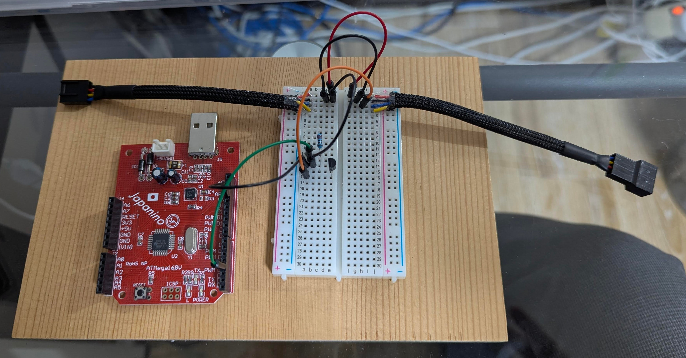
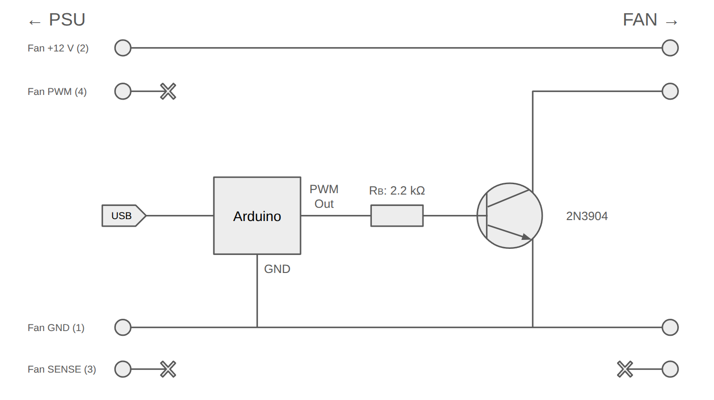

# USB Fan Controller

サーバー向けGPUに取り付けて使う単体で制御できないファンに対し、nvidia-smiで取得した情報を元にUSB経由で回転数制御を行うためのファームウェアとデーモンです。



## ハードウェア

### 部品

| 品名                       | 型番など | 備考                                                                    | リンク                                                        |
| :------------------------- | :------- | :---------------------------------------------------------------------- | :------------------------------------------------------------ |
| Arduino (互換) ボード      | \-       | PWM出力可、USB接続可のものであればOK。                                  |                                                               |
| Fan 4pin 延長ケーブル      | \-       | 切断して間にコントローラーを挿入する。                                  | [https\://amzn.asia/d/0fUqA9oj](https://amzn.asia/d/0fUqA9oj) |
| トランジスタ               | 2N3904   | Amazonの適当な部品セットに含まれている。足の並びが左からEBCなので注意。 | [https\://amzn.asia/d/04nmaraJ](https://amzn.asia/d/04nmaraJ) |
| 抵抗                       | 2.2 kΩ   | Amazonの適当な部品セットに含まれている。                                | [https\://amzn.asia/d/04nmaraJ](https://amzn.asia/d/04nmaraJ) |
| ブレッドボード、配線材など | \-       | 各自用意。                                                              |                                                               |

### 回路図



## ソフトウェア

### Firmware

`firmware/fan_control.ino` を Arduino IDE などでボードに書き込みます。ATmega168/328P (Arduino Pro / Pro Mini 互換) を想定しています。

- D3 (OC2B, Timer2) から PCファン規格の 25 kHz で PWM を出力します。NPNトランジスタ経由でファンのPWM線を駆動する回路のため、Duty は内部で反転して出力します。
- シリアル通信は 9600 bps、コマンドは改行 (`\n` / `\r`) 区切りのテキストです。

| コマンド   | 動作                        | 応答                         |
| :--------- | :-------------------------- | :--------------------------- |
| `0`〜`100` | ファンの Duty 比 [%] を設定 | `OK <duty>` (不正値は `ERR`) |
| `?`        | 現在の Duty 比を取得        | `DUTY <duty>`                |

- フェイルセーフ: 起動直後は Duty 100% です。有効なコマンドを 10 秒間受信しないと Duty を 100% に戻し、`TIMEOUT 100` を返します。

### Daemon

`daemon/fan_control.py` は `nvidia-smi` で GPU の温度を取得し、目標温度を保つように PI 制御で Duty を算出して、シリアル経由でファームウェアへ送信します。

- 温度は名前に `--gpu-name` (default: `V100`) を含む GPU の最高温度を使用します。
- 温度取得に失敗した場合や終了時は、安全のため Duty 100% を送信します。シリアル書き込みに失敗した場合は異常終了します (systemd が再起動します)。

主なオプション:

| オプション                  | default   | 説明                        |
| :-------------------------- | :-------- | :-------------------------- |
| `--device`                  | (必須)    | シリアルデバイス            |
| `--target`                  | 60        | 目標温度 [℃]                |
| `--interval`                | 5         | 取得間隔 [秒]               |
| `--gpu-name`                | V100      | 対象 GPU 名に含まれる文字列 |
| `--min-duty` / `--max-duty` | 30 / 100  | Duty の下限 / 上限 [%]      |
| `--kp` / `--ki`             | 5.0 / 0.5 | PI ゲイン                   |

直接実行:

```bash
python3 daemon/fan_control.py --device /dev/ttyUSB0 --target 60
```

systemd ユーザーサービスとしてインストール (要 `nvidia-smi`、`python3-serial`、`dialout` グループ所属):

```bash
./daemon/setup.sh /dev/serial/by-id/usb-XXXX   # インストール & 有効化
./daemon/setup.sh --uninstall                  # 削除
```

```bash
systemctl --user status fan-control
journalctl --user -u fan-control -f
```
